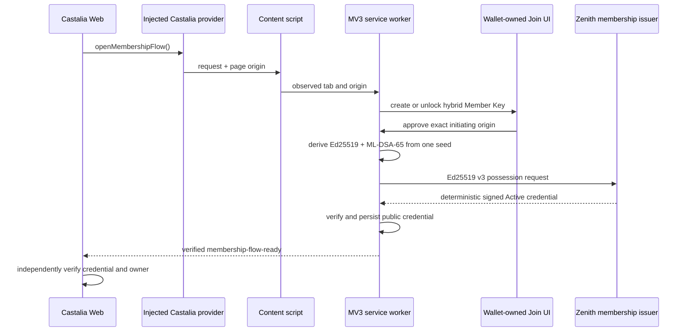

# Castalia Wallet Architecture

The current `/start` integration uses an encrypted durable extension wallet, not an ephemeral page key or a web session. One 32-byte recovery seed reconstructs a Dregg-compatible Ed25519 + ML-DSA-65 identity and descriptor-only preview Cardano, Ethereum/Robinhood, and Solana accounts. Chain balances and transaction signing are not enabled. See [Dregg Hybrid Identity](dregg-hybrid-identity.md) and [Castalia Member Key and Zenith-Signed Membership](castalia-member-key-and-membership-cell.md).

The Member Key is generated and held by the member's wallet. Active Join currently uses a deterministic Zenith-signed v3 credential over the Ed25519 owner anchor. It has no application, Pending state, Control decision, role, capability, web session, or Matrix side effect. The old authority-owned v1 cell model and permissionless Dregg v2 path remain versioned compatibility code, not the active path.

## Product boundary

Castalia Wallet is the human-facing wallet and approval surface. The current Zenith Review/Auth SDK surface is the first browser client. Dregg is the protocol/capability substrate and upstream contribution target. secS-magik is the later private-capability / zk-RPC machine-to-machine layer.

## Active browser architecture

The page never supplies authoritative origin or identity material. The content script/service worker binds the ceremony to the observed initiating tab and origin.

The content script injects a bundled, web-accessible provider IIFE into the page's main world and relays typed requests through the isolated-world bridge. `getSubject()` exposes the public hybrid descriptor, while all private seed and signer material remains in Rust/Wasm custody. Compatibility aliases reuse the same identity; they do not introduce a second key or authentication authority.

The provider exposes `presentCredential()` for the generic credential-bound presentation v2 contract. Wallet verifies issuer trust, holder, caller, audience and exact request/disclosure bindings, then requires a fresh Chrome-owned approval. Applications own semantic request construction, policy and execution. The interactive generic CLI uses the same fixed transcript. Application-specific adapters and native-host orchestration have been [retired](wallet-application-adapter-retirement.md).

## Package responsibilities

- `packages/provider-types`: browser-facing contract.
- `packages/core`: pure helpers for challenge validation, signing, verification, and wallet state.
- `packages/dregg-adapter`: fail-closed client/decoder for an issued Castalia membership cell. It binds exact cell, authority, application commitment, lifecycle state, and receipt head without scanning the ledger.
- `packages/zenith-auth-bridge`: adapter from wallet signatures into current Review/Auth SDK challenge semantics.
- `apps/chrome-extension`: MV3 provider/bridge/popup/service-worker implementation.
